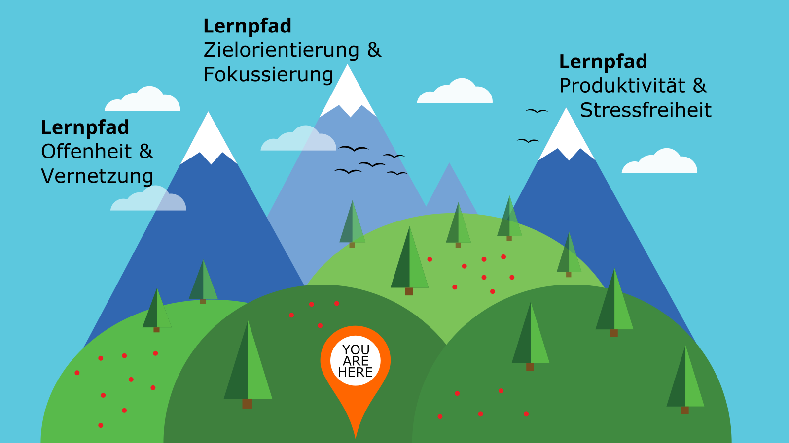

# Lernpfad

Ein lernOS Lernpfad ist eine Zusammenstellung von Übungen (Katas), mit denen du neue Fähigkeiten erlernst und im Lauf der Zeit eine neue Haltung entwickelst. Ein Lernpfad kann innerhalb eines lernOS Sprints durchlaufen werden. lernOS Einsteiger*innen (NOOBs) können zum Start aus einem  drei Lernpfaden "Zielorientierung & Vernetzung", "Produktivität & Stressfreiheit" sowie "Offenheit & Vernetzung" wählen.

**ProTip:** für einen Sprint sollte nur einer der drei Lernpfade gewählt werden. Alle drei Lernpfade können in aufeinanderfolgenden Sprints durchlaufen werden. Tandems und Circles sollten Lernpfade nicht mischen, da ihr sonst im Weekly nicht von den Erfahrungen der anderen profitieren könnt.

Kopiert:

Um die einzelnen Methoden zu erlernen, stellt dieser Leitfaden jeweils einen Lernpfad mit Aufgaben und Übungen zur Verfügung. Mit welchen der Lernpfade du beginnst, hängt an deinen Bedürfnissen. Bist du auf der Suche nach Purpose und dem richtigen Ziel, beginne mit dem Lernpfad Zielorientierung & Fokussierung. Hast du mit Informationsflut und Aufgabenvielfalt zu kämpfen, dann ist der Lernpfad Produktivität & Stressfreiheit der richtige für dich. Hast du das Gefühl, das Rad ständig neu zu erfinden und nicht auf das kollektive Wissen der Welt zugreifen zu können? Dann beginne mit dem Lernpfad Offenheit & Vernetzung.

Die **Woche 0** ist die Woche, bevor es mit den Übungen im Lernpfad so richtig los geht. Nach Abschluss der Woche 0 sollten folgende Dinge festgelegt sein:

1. Welchen Lernpfad du verwendest
2. Ob du alleine, im Tandem oder im Circle lernst
3. Welche Hilfsmittel du zur Selbstorganisation verwendest (z.B. Videokonferenz-Tool für Circle)
4. Bei Tandem und Circle: An welchen Terminen die wöchentlichen Treffen stattfinden und wann du dir zusätzlich Lernzeit im Kalender reserviert hast.
5. Bei Tandem und Circle: ob ihr den Flipped-Classroom-Ansatz wählt und die Katas vor dem Weekly oder im Weekly macht.

Für die Woche 0 gibt es mit dem **Past Forward** und der Arbeit mit dem **lernOS Canvas** (siehe Kapitel in den Grundlagen) zwei zusätzliche Hilfsmittel. Der lernOS Canvas hilft, operative Felder Aufgaben, Projekte, Zielgruppen etc. zu visualisieren und daraus Ziele für diesen oder zukünftige Sprints abzuleiten. Mit dem Past Forward verschaffst du dir in kurzer Zeit Überblick über deine aktuelle Situation, wichtige Ereignisse der Vergangenheit und vor allem deine Vision für die Zukunft.

**Anleitung Past Forward:**

Das Past Forward basiert auf der Methode [The Future, Backwards](https://cognitive-edge.com/methods/the-future-backwards/) von Dave Snowden. Mit dem Past Forward erhält man eine gute Sicht auf die persönliche Gesamtsituation durch einen Blick in die Vergangenheit und auf mögliche Zukünfte. Die Perspektive kann kurzfristig (1-2 Jahre), mittelfristig (3-5 Jahre) oder langfristig (ganzes Leben) sein. So gehst du vor:

1. Bereite deine Past Forward Dokumentation vor ([Beispiel](https://cognitive-edge.com/wp-content/uploads/2015/01/3---ChrisFl-IMG-0058-wpcf_300x225.jpg)). Das kann im einfachsten Fall ein Blatt Papier im Querformat mit einem um 90 Grad nach rechts gedrehten "Y" darauf sein, Das Y stellt die aktuelle Situation (current state), die Vergangenheit, die Vision (heaven), die Anti-Vision (hell) sowie den "Stairway to Heaven" dar. Definiere die Zeitspanne, die du in Vergangenheit und Zukunft schauen möchtest (kurz-/mittel-/langfristig) (5 Minuten)
2. Beschreibe deine aktuelle Situation in in 3-5 kurzen Sätzen (5 Minuten)
3. Beschreibe die 3-5 Schlüssel-Ereignisse in der Vergangenheit, die zur aktuellen Situation geführt haben (5 Minuten)
4. Beschreibe deine Vision in 3-5 kurzen Sätzen (5 Minuten)
5. Beschreibe deine Anti-Vision in 3-5 kurzen Sätzen (5 Minuten)
6. Beschreibe die 3-5 Schlüssel-Aktivitäten oder -Projekte, die deine Vision Wirklichkeit werden lässt und die Anti-Vision verhindert (5 Minuten)

```mermaid
flowchart LR
  %% Layout direction
  %% PAST (left) -> CURRENT (center) -> split UP (green) and DOWN (red)
  
  %% PAST path to CURRENT
  P0((Past)):::pastBig
  P1(( )):::pastSmall
  P2(( )):::pastSmall
  P3(( )):::pastSmall
  P4(( )):::pastSmall
  P5(( )):::pastSmall
  P6(( )):::pastSmall
  
  CS((Current State)):::currentBig
  
  %% UP path to HEAVEN
  U1(( )):::upSmall
  U2(( )):::upSmall
  U3(( )):::upSmall
  U4(( )):::upSmall
  U5(( )):::upSmall
  HV((Heaven)):::upBig
  
  %% DOWN path to HELL
  D1(( )):::downSmall
  D2(( )):::downSmall
  D3(( )):::downSmall
  D4(( )):::downSmall
  D5(( )):::downSmall
  D6(( )):::downSmall
  HL((Hell)):::downBig

  %% --- Edges ---
  P0 ~~~ P1 ~~~ P2 ~~~ P3 ~~~ P4 ~~~ P5 ~~~ P6 ~~~ CS
  CS ~~~ U1 ~~~ U2 ~~~ U3 ~~~ U4 ~~~ U5 ~~~ HV
  CS ~~~ D1 ~~~ D2 ~~~ D3 ~~~ D4 ~~~ D5 ~~~ D6 ~~~ HL

  %% --- Styles ---
  classDef pastBig fill:#b8860b,stroke:#b8860b,stroke-width:2px;
  classDef pastSmall fill:#f3c44e,stroke:#f3c44e,stroke-width:2px;

  classDef currentBig fill:#2f5aa6,stroke:#2f5aa6,stroke-width:2px;

  classDef transSmall fill:#cfe7c7,stroke:#cfe7c7,stroke-width:2px;
  classDef transDotted fill:#cfe7c7,stroke:#6abf4b,stroke-width:2px,stroke-dasharray:5 5;

  classDef upSmall fill:#9bd58e,stroke:#9bd58e,stroke-width:2px;
  classDef upBig fill:#4aa24a,stroke:#4aa24a,stroke-width:2px;

  classDef downSmall fill:#f28b8b,stroke:#f28b8b,stroke-width:2px;
  classDef downBig fill:#e42020,stroke:#e42020,stroke-width:2px;
```

